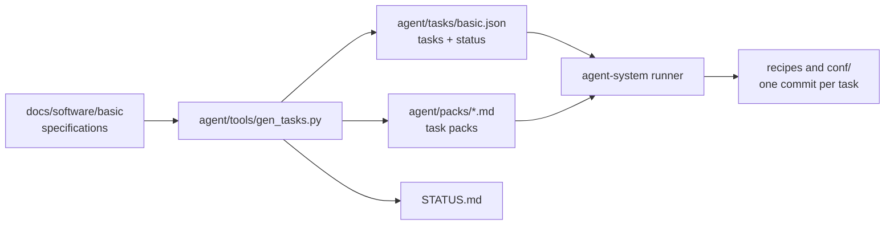

# meta-modberry

[](https://www.techbase.eu/modberry)


Yocto layer for the Techbase Modberry industrial computer, based on the Raspberry Pi Compute Module 4.
**[Show release notes](#9-release-notes-modberry)**

This README describes the content of the `meta-modberry` layer, its specifications, and how the specifications are implemented with the agent system.

## Table of Contents

1. [Overview](#1-overview)
2. [Dependencies](#2-dependencies)
3. [Adding the Layer to a Build](#3-adding-the-layer-to-a-build)
4. [Repository Structure](#4-repository-structure)
5. [Hardware Documentation](#5-hardware-documentation)
6. [Software Specification](#6-software-specification)
7. [Implementation with the Agent System](#7-implementation-with-the-agent-system)
8. [Patches](#8-patches)
9. [Release Notes Modberry](#9-release-notes-modberry)
   - [Release Note Numbering](#release-note-numbering)

---

## 1. Overview

The layer provides the base image for the **Techbase Modberry M40804W MAX** (CM4): machine configuration, board support (device tree, overlays, drivers), base system and security functions.

| Item | Value |
| :-- | :-- |
| Yocto release | `kirkstone` (the migration to a current LTS release is open, see `BASE-BUILD`) |
| Machine (base image) | `modberry-m40804w-max-basic` |
| Common machine configuration | `modberry-m40804w-max` (included by the base machine) |
| Image | `rpi-cm4` ([recipes-core/images/rpi-cm4.bb](recipes-core/images/rpi-cm4.bb)) |
| Bootloader | U-Boot (`RPI_USE_U_BOOT = "1"`) |

**Current and target state:** the target state is defined in the module specifications under [docs/software/basic/](docs/software/basic/README.md). The current recipes (e.g. `dhcpcd`, `init-ifupdown`, `iptables`, `wpa-supplicant`) are replaced task by task by the specified modules (e.g. systemd-networkd, nftables). The progress is shown in [STATUS.md](docs/software/basic/STATUS.md).

---

## 2. Dependencies

This layer depends on:

| Layer | URI | Branch | Requirement |
| :--- | :--- | :--- | :--- |
| `poky` | `<https://github.com/yoctoproject/poky.git>` | `kirkstone` | **Required** |
| `meta-raspberrypi` | `git://git.yoctoproject.org/meta-raspberrypi` | `kirkstone` | **Required** |
| `meta-openembedded` | `<https://github.com/openembedded/meta-openembedded.git>` | `kirkstone` | **Required** |
| `meta-security` | `git://git.yoctoproject.org/meta-security.git` | `kirkstone` | **Required** |
| `meta-virtualization` | `git://git.yoctoproject.org/meta-virtualization` | `kirkstone` | **Required** |
| `meta-edgecon` | `git@github.com:bynacon/meta-edgecon.git` | `kirkstone` | Optional (OTA only, private) |
| `meta-ota` | `<https://github.com/bynacon/meta-ota.git>` | `kirkstone` | Optional (OTA only, private) |

**Note:** the layers `meta-edgecon` and `meta-ota` are required only for builds with OTA update functionality. The OTA machine configurations and all OTA-specific settings are in `meta-ota`; `meta-modberry` contains no OTA configuration. `meta-ota` extends this layer only through the extension points of the modules (e.g. `/etc/nftables.d/`, `/etc/dnsmasq.d/`, image bbappend). A base image (machine: `modberry-m40804w-max-basic.conf`) does not need them.

---

## 3. Adding the Layer to a Build

Run `bitbake-layers add-layer meta-modberry` and add all other dependencies listed above to your `bblayers.conf` file.

Build the base image:

```bash
source poky/oe-init-build-env <build-directory>
MACHINE=modberry-m40804w-max-basic bitbake rpi-cm4
```

Credentials and keys (WLAN, accounts, certificates) belong neither in the repository nor in `local.conf`. They are set on the device during provisioning (`BASE-PROV`, `/data/provisioning/`).

---

## 4. Repository Structure

| Path | Content | Changed by |
| :-- | :-- | :-- |
| [conf/](conf/) | `layer.conf`, machine configurations | developers, agents |
| `recipes-bsp/` | boot files (`config.txt`, cmdline), U-Boot, udev | developers, agents |
| `recipes-connectivity/` | network services (hostapd, dnsmasq, OpenSSH, …) | developers, agents |
| `recipes-core/` | image `rpi-cm4`, systemd, language/locale | developers, agents |
| `recipes-extended/` | libmbus, sudo | developers, agents |
| `recipes-kernel/` | kernel bbappend, device tree patch and overlays (RTC, CAN, TPM, MCP23008, SC16IS740) | developers, agents |
| `recipes-security/` | tpm2-tss | developers, agents |
| [docs/hardware/](docs/hardware/README.md) | hardware specification and datasheets | humans only |
| [docs/software/](docs/software/basic/README.md) | module specifications of the base stack, template `_TEMPLATE.md` | humans only |
| [agent/](agent/playbook.md) | playbook, tasks (`tasks/basic.json`), task packs, generator | generator and runner, never agents directly |

---

## 5. Hardware Documentation

This layer provides the machine configuration for the **Techbase Modberry M40804W MAX**, including basic GPIO assignments and hardware settings.

For detailed hardware specifications, pinouts and implementation notes, only the central hardware documentation is authoritative:
➡️ **[Hardware specification (M40804W_MAX.md)](docs/hardware/M40804W_MAX.md)**

Datasheets are in [docs/hardware/datasheets/](docs/hardware/datasheets/). Device-specific values (UART paths, GPIO numbers, I2C addresses) are defined only in the hardware specification; the software specifications reference it.

---

## 6. Software Specification

The specification of the base stack is in [docs/software/basic/](docs/software/basic/README.md). It defines **what** the image must provide, not how it is implemented.

- **Modules:** 28 modules with the ID `BASE-<MODULE>`, grouped into base system, network (`network/`), boot chain (`boot-chain/`) and hardening (`hardening/`). The overview with dependencies and risk is in the [README of the specification](docs/software/basic/README.md).
- **Requirements:** IDs `BASE-<MODULE>-<NN>` with the levels `MUST`, `SHOULD`, `MAY`; verification levels `build`, `manifest`, `rootfs`, `device`.
- **Spec status:** `planned` → `draft` → `review` → `approved`. Only modules in status `approved` are implemented.
- **Open points:** end as *Decided* or *Deferred*. An open point that needs a measurement on the device or a check of the schematic becomes a verification task (`V-…`).
- **New modules:** follow the template [_TEMPLATE.md](docs/software/_TEMPLATE.md).

---

## 7. Implementation with the Agent System

The specifications are implemented by the separate repository `agent-system` (CrewAI with local LLMs on the ASUS GX10). An agent works on exactly one task per run.



| File | Purpose |
| :-- | :-- |
| [agent/playbook.md](agent/playbook.md) | rules for the agents: write area, kirkstone syntax, no secrets, Definition of Done |
| [agent/tools/gen_tasks.py](agent/tools/gen_tasks.py) | generates one task per section `4.x` from the specifications, plus the task packs and `STATUS.md`; keeps the state of existing tasks |
| `agent/tasks/basic.json` | tasks with phase, dependencies, requirements and state (`status`, `verified`, `evidence`, `notes`) |
| `agent/packs/` | one small context pack per task (only the requirements and repository hints of that task) |
| [docs/software/basic/STATUS.md](docs/software/basic/STATUS.md) | generated implementation status per module – do not edit by hand |

Rules:

- Agents write only to `conf/`, `recipes-*/`, `classes/`, `wic/`, `files/`. `docs/` and `agent/` are locked for them.
- Only the runner writes the task state. Each task ends in its own commit `<task ID>: <summary>` with the requirement IDs. Pushing is done by hand.
- Tasks with a *human gate* end at `implemented`; the device test is done by hand.
- After a change to the specifications, run the generator again:

```bash
python3 agent/tools/gen_tasks.py
```

---

## 8. Patches

Please send all patches for the `meta-modberry` layer to the Bynacon maintainer:  
**Ben Roethlisberger** - `ben.roethlisberger@bynacon.ch`

---

## 9. Release Notes Modberry

### Release Note Numbering

Numbering of the release notes (e.g. `5.04.12.023`):

- **First number (5):** device version (5 = Modberry)
- **Second number (04):** major release number
- **Third number (12):** sub-version number
- **Fourth number (023):** patch number

### Release 5.00.00.001

- **First commit:** default configuration for Modberry M40804W MAX.
- Basic GPIO assignments defined.
