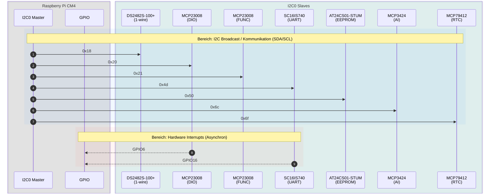
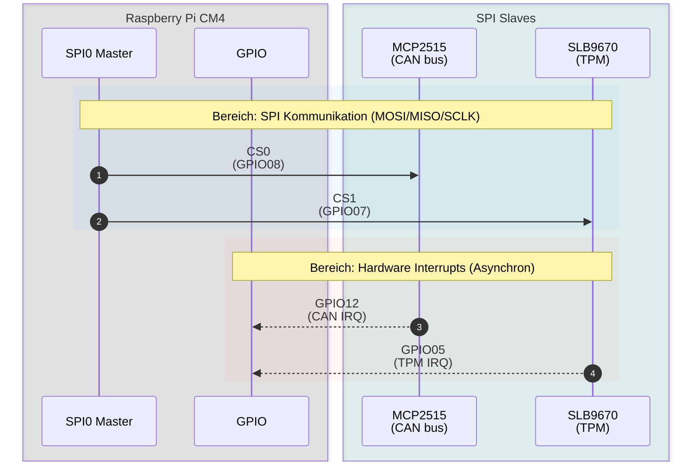
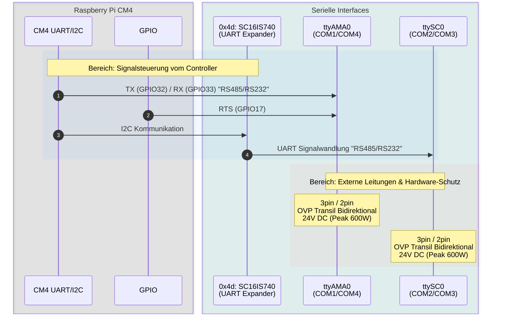

<p align="center">
  <a href="https://www.techbase.eu/modberry">
    
  </a>
</p>

<h1 align="center">Hardware-Spezifikation: Modberry M40804W MAX</h1>

This document serves as the single source of truth for the Modberry hardware interfaces, pinouts, and expected kernel/device-tree configurations.

<!-- TABLE OF CONTENTS -->
<details>
  <summary>Inhaltsverzeichnis</summary>
  <ol>
    <li><a href="#1-kernkomponenten">Kernkomponenten</a></li>
    <li><a href="#2-gpio-pinout-mapping-bcm--cm4-native">GPIO Pinout Mapping</a></li>
    <li><a href="#3-bus--und-geräteschnittstellen">Bus- & Geräteschnittstellen</a>
      <ul>
        <li><a href="#31-i2c0-interner-bus">I2C0 (Interner Bus)</a></li>
        <li><a href="#32-spi0-bus">SPI0 Bus</a></li>
        <li><a href="#33-uart--serielle-verbindungen">UART / Serielle Verbindungen</a></li>
      </ul>
    </li>
    <li><a href="#4-digitale-e-a-charakteristiken">Digitale E/A Charakteristiken</a></li>
    <li><a href="#5-netzwerk--zusätzliche-schnittstellen">Netzwerk & Zusätzliche Schnittstellen</a></li>
    <li><a href="#6-hardware-einschränkungen--hinweise">Hardware-Einschränkungen & Hinweise</a></li>
    <li><a href="#7-code-beispiele--hardware-nutzung-sysfs">Code-Beispiele & Hardware-Nutzung (Sysfs)</a></li>
    <li><a href="#8-implementierungsstatus-yocto--device-tree-todos">Implementierungsstatus (Yocto / Device Tree)</a></li>
  </ol>
</details>

## 1. Kernkomponenten

- **CPU:** Raspberry Pi Compute Module 4 (CM4)
- **TPM:** Infineon SLB9670
- **CAN Controller:** Microchip MCP2515
- **GPIO Expander:** Microchip MCP23008
- **UART Expander:** NXP SC16IS740
- **RTC:** MCP79412
- **EEPROM:** AT24CS01-STUM

## 2. GPIO Pinout Mapping (BCM / CM4 Native)

- **GPIO00 / GPIO01:** I2C1 (SDA1 / SCL1)
- **GPIO02 / 03 / 04:** Unassigned / Not evaluated
- **GPIO05:** IRQ LINE SLB9670 TPM
- **GPIO06:** IRQ LINE MCP23008 DIO
- **GPIO07:** SPI0 CE1 (SLB9670 TPM)
- **GPIO08:** SPI0 CE0 (MCP2515 CAN)
- **GPIO09 / 10 / 11:** SPI0 (MISO / MOSI / SCLK)
- **GPIO12:** IRQ LINE MCP2515 CAN bus
- **GPIO13:** USER BUTTON
- **GPIO14 / GPIO15:** TXD0 / RXD0
- **GPIO16:** IRQ Line SC16IS740 RS485/RS232
- **GPIO17:** RTS1 ttyAMA0
- **GPIO18 / 19 / 20 / 21:** Digital Inputs (DI)
- **GPIO22 / 23 / 24 / 25:** Digital Outputs (DO)
- **GPIO26:** Unassigned / Not evaluated
- **GPIO27:** LED2 (GREEN/BLUE)
- **GPIO32 / GPIO33:** TXD1 / RXD1 (ttyAMA0)
- **GPIO44 / GPIO45:** ALT1 I2C0 (SDA0 / SCL0)

## 3. Bus- & Geräteschnittstellen

### 3.1 I2C0 (Interner Bus)

Am internen I2C-Bus angeschlossene Geräte:

- **0x18:** DS2482S-100+ (1-wire interface) / no IRQ line
- **0x20:** MCP23008 (Digital I/O - DIO1 to DIO4) / IRQ LINE GPIO06
- **0x21:** MCP23008 (Function Block: LED1, LED2, BUZZER, PCI/POWER/RESET)
- **0x4d:** SC16IS740 (RS485/RS232 COM2/COM3 over I2C) / IRQ LINE GPIO16
- **0x50:** AT24CS01-STUM (EEPROM)
- **0x6c:** MCP3424 (Analog Input 0-10 VDC)
- **0x6f:** MCP79412 (RTC)



### 3.2 SPI0 Bus

- **CS0 (GPIO08):** Microchip MCP2515 (CAN bus). Uses **GPIO12** for interrupts. Requires 24V DC bidirectional overvoltage protection (Peak 600W). *(Note: Legacy INF ambiguously referenced this as CS1)*
- **CS1 (GPIO07):** Infineon SLB9670 (TPM). Uses **GPIO05** for interrupts. *(Note: Legacy INF ambiguously referenced this as CS0)*



### 3.3 UART / Serielle Verbindungen

- **ttyAMA0 (COM1/COM4):** RS485/RS232 using TX (GPIO32), RX (GPIO33), and RTS (GPIO17). 3pin / 2pin, overvoltage protection transil bidirectional 24V DC (Peak 600W).
- **ttySC0 (COM2/COM3):** RS485/RS232 routed through the I2C UART Expander (SC16IS740 at 0x4d). 3pin / 2pin, overvoltage protection transil bidirectional 24V DC (Peak 600W).



## 4. Digitale E/A Charakteristiken

### 4.1 Digitale Eingänge (DI)

- Quantity: 4x DI
- VIL: 0 - 0.5 VDC
- VIH: 1.5 - 30 VDC
- Pull-Up: 3.3 VDC
- Protection: Transil unidirectional 30V DC (Peak min 600W)
... (Characteristics mapped)

### 4.2 Digitale Ausgänge (DO)

- Quantity: 4x DO (Open Collector)
- Max Voltage: 30 VDC
- Max Current Load: 500 mA
- Protection: Transil unidirectional 30V DC (Peak min 600W)

## 5. Network & Additional Interfaces

- **Ethernet 1 (LAN1, IoT):** 100Mbps via LAN9514I-JZX (USB, driver `smsc95xx`)
- **Ethernet 2 (LAN0, service & uplink):** 1Gbps via the CM4 on-board PHY BCM54210PE (driver `bcmgenet`) *(Open: confirm against the schematic.)*
- **USB Host:** via LAN9514I-JZX

## 6. Hardware-Einschränkungen & Hinweise

- **PCIe:** 2x PCI-Express interfaces are **not available** on this hardware variant.
- **SIM Card / GPRS:** PCIE extension for GPRS SIM Card is **not available**. Legacy `wvdial` configs via `/dev/ttyUSB0` apply only if custom USB modems are externally attached.

*Referenz für `wvdial.conf`:*

```ini
  [Dialer play]
  Modem = /dev/ttyUSB0
  Baud = 230400
  Init1 = ATH
  Init2 = ATE1
  Init3 = AT+CGDCONT=1,"IP","internet"
  Dial Command = ATD
  Phone = *99#
  Stupid mode = yes
  Username = "blank"
  Password = "blank"
```

- **Ethernet/USB:** Ports are routed via LAN9514I-JZX (100Mbps Ethernet + USB port).

## 7. Code-Beispiele & Hardware-Nutzung (Sysfs)

### I2C0 Bus Detection & Setup

**Standard I2C0 Matrix Dump:**

```text
    0  1  2  3  4  5  6  7  8  9  a  b  c  d  e  f
00:                         -- -- -- -- -- -- -- -- 
10: -- -- -- -- -- -- -- -- 18 -- -- -- -- -- -- -- 
20: 20 21 -- -- -- -- -- -- -- -- -- -- -- -- -- -- 
30: -- -- -- -- -- -- -- -- -- -- -- -- -- -- -- -- 
40: -- -- -- -- -- -- -- -- -- -- -- -- -- 4d -- -- 
50: 50 -- -- -- -- -- -- -- 58 -- -- -- -- -- -- -- 
60: -- -- -- -- -- -- -- -- -- -- -- -- 6c -- -- 6f 
70: -- -- -- -- -- -- -- --               
```

*Treiber dynamisch laden (Beispiel):*
`echo MCP23017 "0x27" > /sys/bus/i2c/devices/i2c-0/new_device`

### Native Digital I/O (GPIO 18-25)

**Beispiel Digital Input (z.B. DI1 = GPIO 18):**

```bash
echo 18 > /sys/class/gpio/export
cat /sys/class/gpio/gpio18/value
```

**Beispiel Digital Output (z.B. DO1 = GPIO 22):**

```bash
echo 22 > /sys/class/gpio/export
echo out > /sys/class/gpio/gpio22/direction
echo 1 > /sys/class/gpio/gpio22/value
```

### MCP23008 DIO Expander (I2C 0x20)

Mapping der Sysfs-Nummern für DIO 1-4 (abhängig vom Kernel-Base-Offset):

- **DIO 1:** IN 500 (GP4) / OUT 496 (GP0)
- **DIO 2:** IN 501 (GP5) / OUT 497 (GP1)
- **DIO 3:** IN 502 (GP6) / OUT 498 (GP2)
- **DIO 4:** IN 503 (GP7) / OUT 499 (GP3) *(Note: Legacy INF lists IN 503 as GP4, which is likely a typo)*

*Modus auf Output setzen (Beispiel DIO 1 & 2):*

```bash
echo 496 > /sys/class/gpio/export && echo out > /sys/class/gpio/gpio496/direction
echo 497 > /sys/class/gpio/export && echo out > /sys/class/gpio/gpio497/direction
echo 500 > /sys/class/gpio/export && echo in > /sys/class/gpio/gpio500/direction
echo 501 > /sys/class/gpio/export && echo in > /sys/class/gpio/gpio501/direction
```

*Modus auf Input setzen (Beispiel DIO 1 & 2):*

```bash
echo 496 > /sys/class/gpio/export && echo in > /sys/class/gpio/gpio496/direction
echo 497 > /sys/class/gpio/export && echo in > /sys/class/gpio/gpio497/direction
echo 500 > /sys/class/gpio/export && echo in > /sys/class/gpio/gpio500/direction
echo 501 > /sys/class/gpio/export && echo in > /sys/class/gpio/gpio501/direction
```

### MCP23008 Function Block (I2C 0x21)

Interne Steuerung für LEDs, Buzzer und PCI/Power.

- **LED1:** 489 (GP1 - RED)
- **BUZZER:** 493 (GP5)

*Beispiel via LED-Subsystem:*

```bash
echo 255 > /sys/class/leds/LED1/brightness
sleep 2
echo 0 > /sys/class/leds/LED1/brightness
```

### RS485 / RS232 Modi (ttyAMA0 & ttySC0)

Die seriellen Schnittstellen `ttyAMA0` (COM1/COM4) und `ttySC0` (COM2/COM3) können jeweils im RS-232 oder RS-485 Modus betrieben werden. Vor der ersten Kommunikation muss der entsprechende Modus konfiguriert werden. Standardmäßig arbeitet `ttyAMA0` (COM2 - RS232) als Service-Port.

## 8. Implementation Status (Yocto / Device Tree TODOs)

This table tracks the driver and device tree implementations based on the hardware interfaces.

| Implemented | Review | Test | Komponente (Feature) | Interface / Pin | Beschreibung & Notes |
| :---: | :---: | :---: | :--- | :--- | :--- |
| [x] | [ ] | [ ] | **Base Pinmuxing** | GPIO / I2C / SPI | Completed in `0001-mood-modberry-cm4-dts.patch` and `config.txt`. |
| [x] | [ ] | [ ] | **I2C0 Bus Mapping** | I2C0 | Bus active, basic configuration verified. |
| [x] | [ ] | [ ] | **RTC (MCP79412)** | I2C0 0x6f | Implemented. |
| [ ] | [ ] | [ ] | **CAN Bus (MCP2515)** | SPI0 CS0 (GPIO08) | Implement CAN interface. IRQ: GPIO12. Req: 24V DC overvoltage protection. |
| [ ] | [ ] | [ ] | **TPM (SLB9670)** | SPI0 CS1 (GPIO07) | Implement TPM. IRQ: GPIO05. *Note: Check Bootloader integration.* |
| [ ] | [ ] | [ ] | **RS485/RS232 (ttyAMA0)**| TX:32, RX:33, RTS:17 | Implement COM1/COM4 over GPIO. |
| [ ] | [ ] | [ ] | **Digital I/O (Native)** | GPIO 18-25 | Implement user-space access for DI (18-21) and DO (22-25). |
| [ ] | [ ] | [ ] | **1-Wire (DS2482S-100+)** | I2C0 0x18 | Implement 1-wire interface. No IRQ line. |
| [ ] | [ ] | [ ] | **DIO Expander (MCP23008)** | I2C0 0x20 | Implement Digital I/O expander. IRQ: GPIO06. |
| [ ] | [ ] | [ ] | **Function Block (MCP23008)** | I2C0 0x21 | Implement internal controls (LEDs, Buzzer). |
| [ ] | [ ] | [ ] | **UART Expander (SC16IS740)** | I2C0 0x4d | Implement RS485/RS232 (ttySC0). IRQ: GPIO16. |
| [ ] | [ ] | [ ] | **EEPROM (AT24CS01-STUM)** | I2C0 0x50 | Implement EEPROM storage. |
| [ ] | [ ] | [ ] | **Analog Input (MCP3424)** | I2C0 0x6c | Implement 0-10 VDC Analog Input. |
| [ ] | [ ] | [ ] | **Ethernet/USB (LAN9514I-JZX)** | USB / Network | Implement 100Mbps Ethernet & USB port routing. |
