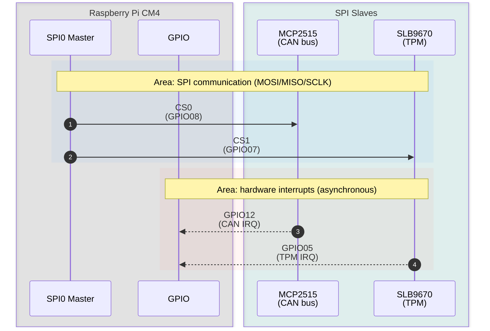
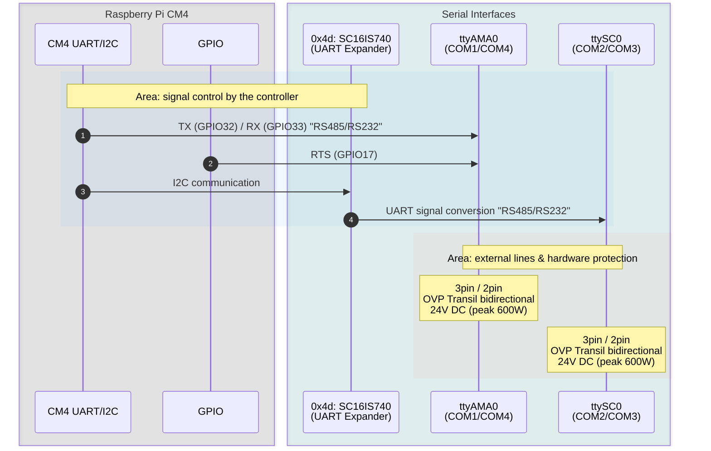

# Hardware Specification: Modberry M40804W MAX

[](https://www.techbase.eu/modberry)

This document serves as the single source of truth for the Modberry hardware interfaces, pinouts, and expected kernel/device-tree configurations.

## Table of Contents

1. [Core Components](#1-core-components)
2. [GPIO Assignment](#2-gpio-assignment)
3. [Bus and Device Interfaces](#3-bus-and-device-interfaces)
   1. [I2C0 (internal bus)](#31-i2c0-internal-bus)
   2. [SPI0](#32-spi0)
   3. [UART / Serial Interfaces](#33-uart--serial-interfaces)
4. [Digital Inputs and Outputs](#4-digital-inputs-and-outputs)
5. [Network and USB](#5-network-and-usb)
6. [Limitations and Notes](#6-limitations-and-notes)
7. [Code Examples (sysfs)](#7-code-examples-sysfs)
8. [Implementation in the Software](#8-implementation-in-the-software)

## 1. Core Components

| Component | Part | Connection |
| :-- | :-- | :-- |
| CPU | Raspberry Pi Compute Module 4 (CM4) | — |
| TPM | Infineon SLB9670 | SPI0 CS1, IRQ GPIO05 |
| CAN controller | Microchip MCP2515 | SPI0 CS0, IRQ GPIO12 |
| GPIO expander | Microchip MCP23008 (2×) | I2C0 0x20 (DIO), 0x21 (function block) |
| UART expander | NXP SC16IS740 | I2C0 0x4d, IRQ GPIO16 |
| 1-Wire bridge | Maxim DS2482S-100+ | I2C0 0x18 |
| ADC | Microchip MCP3424 | I2C0 0x6c |
| RTC | Microchip MCP79412 (battery-backed, keeps the time during a power failure) | I2C0 0x6f |
| EEPROM | Microchip AT24CS01-STUM | I2C0 0x50 |
| USB hub / Ethernet | Microchip LAN9514I-JZX | USB |

## 2. GPIO Assignment

BCM numbering of the CM4. DI1–DI4 and DO1–DO4 are numbered in ascending GPIO order (DI1 = GPIO18, DO1 = GPIO22, see section 7).

| GPIO | Function | Signal | Device / Interface | Direction |
| :-: | :-- | :-- | :-- | :-: |
| 0 | I2C1 | SDA1 | I2C1 bus | I/O |
| 1 | I2C1 | SCL1 | I2C1 bus | O |
| 2 | — | — | not assigned / not evaluated | — |
| 3 | — | — | not assigned / not evaluated | — |
| 4 | — | — | not assigned / not evaluated | — |
| 5 | Interrupt | TPM IRQ | SLB9670 (SPI0 CS1) | I |
| 6 | Interrupt | DIO IRQ | MCP23008 (I2C0 0x20) | I |
| 7 | SPI0 | CE1 | SLB9670 (TPM) | O |
| 8 | SPI0 | CE0 | MCP2515 (CAN) | O |
| 9 | SPI0 | MISO | SPI0 bus | I |
| 10 | SPI0 | MOSI | SPI0 bus | O |
| 11 | SPI0 | SCLK | SPI0 bus | O |
| 12 | Interrupt | CAN IRQ | MCP2515 (SPI0 CS0) | I |
| 13 | Input | User button | push button | I |
| 14 | UART0 | TXD0 | — | O |
| 15 | UART0 | RXD0 | — | I |
| 16 | Interrupt | UART IRQ | SC16IS740 (I2C0 0x4d) | I |
| 17 | UART | RTS1 | `ttyAMA0` (COM1/COM4) | O |
| 18 | Digital in | DI1 | terminal DI1 | I |
| 19 | Digital in | DI2 | terminal DI2 | I |
| 20 | Digital in | DI3 | terminal DI3 | I |
| 21 | Digital in | DI4 | terminal DI4 | I |
| 22 | Digital out | DO1 | terminal DO1 (open collector) | O |
| 23 | Digital out | DO2 | terminal DO2 (open collector) | O |
| 24 | Digital out | DO3 | terminal DO3 (open collector) | O |
| 25 | Digital out | DO4 | terminal DO4 (open collector) | O |
| 26 | — | — | not used | — |
| 27 | Output | LED2 | LED green/blue | O |
| 32 | UART | TXD1 | `ttyAMA0` (COM1/COM4) | O |
| 33 | UART | RXD1 | `ttyAMA0` (COM1/COM4) | I |
| 44 | I2C0 (ALT1) | SDA0 | internal I2C0 bus | I/O |
| 45 | I2C0 (ALT1) | SCL0 | internal I2C0 bus | O |

### Overview by Function

| Function | GPIOs |
| :-- | :-- |
| Interrupts | 5 (TPM), 6 (DIO expander), 12 (CAN), 16 (UART expander) |
| SPI0 | 7 (CE1 TPM), 8 (CE0 CAN), 9–11 (MISO/MOSI/SCLK) |
| I2C | 0–1 (I2C1), 44–45 (I2C0, internal) |
| UART | 14–15 (UART0), 17 + 32–33 (`ttyAMA0`) |
| Digital inputs/outputs | 18–21 (DI1–DI4), 22–25 (DO1–DO4) |
| Operation / display | 13 (user button), 27 (LED2) |
| Not assigned / not used | 2, 3, 4, 26 |

## 3. Bus and Device Interfaces

### 3.1 I2C0 (internal bus)

| Address | Part | Function | IRQ |
| :-: | :-- | :-- | :-: |
| 0x18 | DS2482S-100+ | 1-Wire interface | — |
| 0x20 | MCP23008 | Digital I/O DIO1–DIO4 | GPIO06 |
| 0x21 | MCP23008 | Function block: LED1, LED2, buzzer, PCI/power/reset | — |
| 0x4d | SC16IS740 | RS485/RS232 COM2/COM3 (`ttySC0`) | GPIO16 |
| 0x50 | AT24CS01-STUM | EEPROM | — |
| 0x6c | MCP3424 | Analog input 0–10 VDC | — |
| 0x6f | MCP79412 | RTC | — |


### 3.2 SPI0

| Chip select | GPIO | Part | IRQ | Notes |
| :-- | :-: | :-- | :-: | :-- |
| CS0 | 8 | MCP2515 (CAN) | GPIO12 | 24 V DC bidirectional overvoltage protection (peak 600 W). *The legacy INF wrongly called this CS CS1.* |
| CS1 | 7 | SLB9670 (TPM) | GPIO05 | *The legacy INF wrongly called this CS CS0.* |



### 3.3 UART / Serial Interfaces

| Device | Connectors | Connection | Modes | Protection |
| :-- | :-- | :-- | :-- | :-- |
| `ttyAMA0` | COM1 / COM4 | CM4 UART: TX GPIO32, RX GPIO33, RTS GPIO17 | RS232 / RS485 switchable, 3-pin / 2-pin; **service port** (can be switched on/off) | Transil bidirectional 24 V DC (peak 600 W) |
| `ttySC0` | COM2 / COM3 | SC16IS740 on I2C0 0x4d, IRQ GPIO16 | RS232 / RS485 switchable, 3-pin / 2-pin | Transil bidirectional 24 V DC (peak 600 W) |



## 4. Digital Inputs and Outputs

| Property | Digital inputs (DI) | Digital outputs (DO) |
| :-- | :-- | :-- |
| Count | 4 (GPIO18–21) | 4 (GPIO22–25), open collector |
| Level | VIL 0–0.5 VDC, VIH 1.5–30 VDC | max. 30 VDC |
| Pull-up / load | pull-up 3.3 VDC | max. 500 mA |
| Protection | Transil unidirectional 30 V DC (peak min. 600 W) | Transil unidirectional 30 V DC (peak min. 600 W) |

## 5. Network and USB

| Interface | Role | Part | Driver | Note |
| :-- | :-- | :-- | :-- | :-- |
| Ethernet 1 | LAN1 (IoT) | LAN9514I-JZX, 100 Mbit/s (via USB) | `smsc95xx` | — |
| Ethernet 2 | LAN0 (service & uplink) | CM4 PHY BCM54210PE, 1 Gbit/s | `bcmgenet` | *Open: confirm against the schematic.* |
| USB host | USB port | LAN9514I-JZX | — | Ethernet 1 and the USB port are on the same LAN9514 |

## 6. Limitations and Notes

- **PCIe:** 2× PCI Express is **not available** on this hardware variant.
- **SIM card / GPRS:** the PCIe extension for a GPRS SIM card is **not available**. The old `wvdial` configurations via `/dev/ttyUSB0` apply only if a USB modem is connected externally.

*Reference for `wvdial.conf`:*

```ini
  [Dialer play]
  Modem = /dev/ttyUSB0
  Baud = 230400
  Init1 = ATH
  Init2 = ATE1
  Init3 = AT+CGDCONT=1,"IP","internet"
  Dial Command = ATD
  Phone = *99#
  Stupid mode = yes
  Username = "blank"
  Password = "blank"
```

## 7. Code Examples (sysfs)

### I2C0 Bus Detection & Setup

**Standard I2C0 matrix dump:**

```text
    0  1  2  3  4  5  6  7  8  9  a  b  c  d  e  f
00:                         -- -- -- -- -- -- -- --
10: -- -- -- -- -- -- -- -- 18 -- -- -- -- -- -- --
20: 20 21 -- -- -- -- -- -- -- -- -- -- -- -- -- --
30: -- -- -- -- -- -- -- -- -- -- -- -- -- -- -- --
40: -- -- -- -- -- -- -- -- -- -- -- -- -- 4d -- --
50: 50 -- -- -- -- -- -- -- 58 -- -- -- -- -- -- --
60: -- -- -- -- -- -- -- -- -- -- -- -- 6c -- -- 6f
70: -- -- -- -- -- -- -- --
```

*Load a driver dynamically (example):*
`echo MCP23017 "0x27" > /sys/bus/i2c/devices/i2c-0/new_device`

### Native Digital I/O (GPIO 18–25)

**Example digital input (DI1 = GPIO 18):**

```bash
echo 18 > /sys/class/gpio/export
cat /sys/class/gpio/gpio18/value
```

**Example digital output (DO1 = GPIO 22):**

```bash
echo 22 > /sys/class/gpio/export
echo out > /sys/class/gpio/gpio22/direction
echo 1 > /sys/class/gpio/gpio22/value
```

### MCP23008 DIO Expander (I2C 0x20)

Mapping of the sysfs numbers for DIO 1–4 (depends on the kernel base offset):

| DIO | Input (sysfs / pin) | Output (sysfs / pin) |
| :-: | :-- | :-- |
| 1 | 500 / GP4 | 496 / GP0 |
| 2 | 501 / GP5 | 497 / GP1 |
| 3 | 502 / GP6 | 498 / GP2 |
| 4 | 503 / GP7 | 499 / GP3 |

*The legacy INF names GP4 for IN 503; this is probably a typo.*

*Set the mode to output (example DIO 1 & 2):*

```bash
echo 496 > /sys/class/gpio/export && echo out > /sys/class/gpio/gpio496/direction
echo 497 > /sys/class/gpio/export && echo out > /sys/class/gpio/gpio497/direction
echo 500 > /sys/class/gpio/export && echo in > /sys/class/gpio/gpio500/direction
echo 501 > /sys/class/gpio/export && echo in > /sys/class/gpio/gpio501/direction
```

*Set the mode to input (example DIO 1 & 2):*

```bash
echo 496 > /sys/class/gpio/export && echo in > /sys/class/gpio/gpio496/direction
echo 497 > /sys/class/gpio/export && echo in > /sys/class/gpio/gpio497/direction
echo 500 > /sys/class/gpio/export && echo in > /sys/class/gpio/gpio500/direction
echo 501 > /sys/class/gpio/export && echo in > /sys/class/gpio/gpio501/direction
```

### MCP23008 Function Block (I2C 0x21)

Internal control of the LEDs, buzzer and PCI/power.

| Function | sysfs | Pin |
| :-- | :-: | :-- |
| LED1 (red) | 489 | MCP23008 0x21, GP1 |
| LED2 (green/blue) | 27 | CM4 GPIO27 (native) |
| Buzzer | 493 | MCP23008 0x21, GP5 |
| User button | 13 | CM4 GPIO13 (native) |

*Note: 489 and 493 can be exported only when the driver for the MCP23008 at 0x21 is loaded. GP1 and GP5 are the pin numbers of this expander; the sysfs numbers result from the base of the chip (here 488, for the DIO expander 0x20: 496) and can change with the kernel. The other pins of 0x21 (GP0, GP2–GP4, GP6, GP7) belong to PCI/power/reset and are not intended for applications.*

*Example via the LED subsystem:*

```bash
echo 255 > /sys/class/leds/LED1/brightness
sleep 2
echo 0 > /sys/class/leds/LED1/brightness
```

### RS485 / RS232 Modes (ttyAMA0 & ttySC0)

The serial interfaces `ttyAMA0` (COM1/COM4) and `ttySC0` (COM2/COM3) can be switched between RS-232 and RS-485. The switching is done **by software**; there is no jumper. The mode must be configured before the first communication.

| UART | RS-485 direction control | Switching |
| :-- | :-- | :-- |
| `ttyAMA0` (COM1/COM4) | RTS = GPIO17 | Linux RS-485 API (`TIOCSRS485`) |
| `ttySC0` (COM2/COM3) | RTS of the SC16IS740 | Linux RS-485 API (`TIOCSRS485`) |

Reference: <https://sourceforge.net/p/arduino-icsc/wiki/Raspberry%20Pi/>. The direction control shown there via direct register access (`/dev/mem`) is not used (see `BASE-HWT-26`).

`ttyAMA0` (COM1/COM4) is the **service port**. It can be switched on and off; the software requirements for it are in `docs/software/basic`.

## 8. Implementation in the Software

The implementation status is not kept in this specification but in [`docs/software/basic/STATUS.md`](../software/basic/STATUS.md) (generated from `agent/tasks/basic.json`). The table shows which requirements cover the parts of this hardware.

| Component | Interface / pin | Requirements |
| :-- | :-- | :-- |
| Board device tree, pinmuxing | GPIO / I2C / SPI | `BASE-BSP-01` … `BASE-BSP-03` |
| RTC (MCP79412) | I2C0 0x6f | `BASE-BSP-10`, `BASE-TIME-20` … `BASE-TIME-22` |
| CAN (MCP2515) | SPI0 CS0, IRQ GPIO12 | `BASE-HWT-10`, `BASE-HWT-11`, `BASE-NETD-40` |
| TPM (SLB9670) | SPI0 CS1, IRQ GPIO05 | `BASE-TPM-01` … `BASE-TPM-04` |
| RS485/RS232 `ttyAMA0` (COM1/COM4) | TX 32, RX 33, RTS 17 | `BASE-HWT-13`, `BASE-HWT-20`, `BASE-HWT-25`, `BASE-HWT-30` … `BASE-HWT-36` |
| RS485/RS232 `ttySC0` (COM2/COM3) | SC16IS740 I2C0 0x4d, IRQ GPIO16 | `BASE-HWT-13`, `BASE-HWT-20`, `BASE-HWT-25` |
| Digital I/O (native) | GPIO 18–25 | `BASE-BSP-20` … `BASE-BSP-24` |
| DIO expander (MCP23008) | I2C0 0x20, IRQ GPIO06 | `BASE-BSP-14`, `BASE-BSP-20` … `BASE-BSP-22` |
| Function block (MCP23008) | I2C0 0x21 | `BASE-BSP-15`, `BASE-BSP-16` |
| 1-Wire (DS2482S-100+) | I2C0 0x18 | `BASE-BSP-13` |
| EEPROM (AT24CS01) | I2C0 0x50 | `BASE-BSP-11`, `BASE-PROV-33` |
| Analog input (MCP3424) | I2C0 0x6c | `BASE-BSP-12` |
| Ethernet / USB (LAN9514I-JZX) | USB | `BASE-NETD-20`, `BASE-USB-04` |
| User button | GPIO13 | `BASE-HWT-33` |
| WLAN / Bluetooth (CM4) | — | `BASE-WAP`, `BASE-BLE` |
