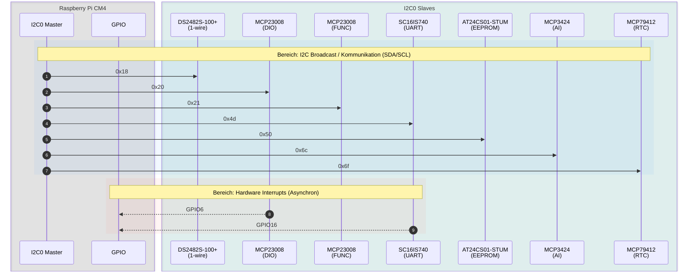
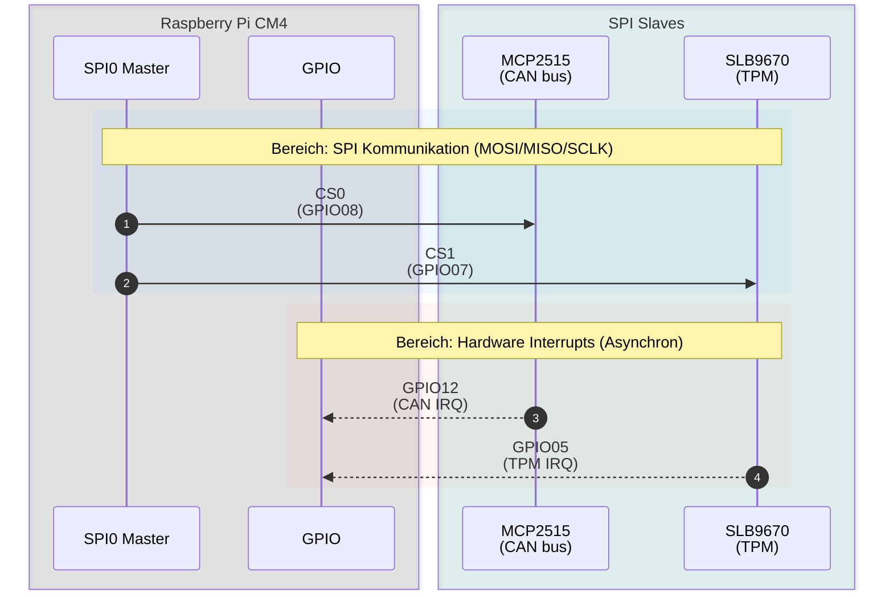
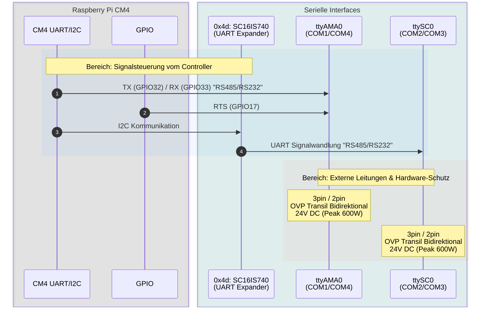

# Hardware-Spezifikation: Modberry M40804W MAX

[](https://www.techbase.eu/modberry)

This document serves as the single source of truth for the Modberry hardware interfaces, pinouts, and expected kernel/device-tree configurations.

## Inhaltsverzeichnis

1. [Kernkomponenten](#1-kernkomponenten)
2. [GPIO-Belegung](#2-gpio-belegung)
3. [Bus- und Geräteschnittstellen](#3-bus--und-geräteschnittstellen)
   1. [I2C0 (interner Bus)](#31-i2c0-interner-bus)
   2. [SPI0](#32-spi0)
   3. [UART / serielle Schnittstellen](#33-uart--serielle-schnittstellen)
4. [Digitale Ein- und Ausgänge](#4-digitale-ein--und-ausgänge)
5. [Netzwerk und USB](#5-netzwerk-und-usb)
6. [Einschränkungen und Hinweise](#6-einschränkungen-und-hinweise)
7. [Code-Beispiele (sysfs)](#7-code-beispiele-sysfs)
8. [Implementierungsstatus](#8-implementierungsstatus)

## 1. Kernkomponenten

| Komponente | Baustein | Anbindung |
| :-- | :-- | :-- |
| CPU | Raspberry Pi Compute Module 4 (CM4) | — |
| TPM | Infineon SLB9670 | SPI0 CS1, IRQ GPIO05 |
| CAN-Controller | Microchip MCP2515 | SPI0 CS0, IRQ GPIO12 |
| GPIO-Expander | Microchip MCP23008 (2×) | I2C0 0x20 (DIO), 0x21 (Function Block) |
| UART-Expander | NXP SC16IS740 | I2C0 0x4d, IRQ GPIO16 |
| 1-Wire-Bridge | Maxim DS2482S-100+ | I2C0 0x18 |
| ADC | Microchip MCP3424 | I2C0 0x6c |
| RTC | Microchip MCP79412 | I2C0 0x6f |
| EEPROM | Microchip AT24CS01-STUM | I2C0 0x50 |
| USB-Hub / Ethernet | Microchip LAN9514I-JZX | USB |

## 2. GPIO-Belegung

BCM-Nummerierung des CM4. DI1–DI4 und DO1–DO4 sind in aufsteigender GPIO-Reihenfolge nummeriert (DI1 = GPIO18, DO1 = GPIO22, siehe Abschnitt 7).

| GPIO | Funktion | Signal | Gerät / Schnittstelle | Richtung |
| :-: | :-- | :-- | :-- | :-: |
| 0 | I2C1 | SDA1 | I2C1-Bus | I/O |
| 1 | I2C1 | SCL1 | I2C1-Bus | O |
| 2 | — | — | nicht belegt / nicht evaluiert | — |
| 3 | — | — | nicht belegt / nicht evaluiert | — |
| 4 | — | — | nicht belegt / nicht evaluiert | — |
| 5 | Interrupt | TPM IRQ | SLB9670 (SPI0 CS1) | I |
| 6 | Interrupt | DIO IRQ | MCP23008 (I2C0 0x20) | I |
| 7 | SPI0 | CE1 | SLB9670 (TPM) | O |
| 8 | SPI0 | CE0 | MCP2515 (CAN) | O |
| 9 | SPI0 | MISO | SPI0-Bus | I |
| 10 | SPI0 | MOSI | SPI0-Bus | O |
| 11 | SPI0 | SCLK | SPI0-Bus | O |
| 12 | Interrupt | CAN IRQ | MCP2515 (SPI0 CS0) | I |
| 13 | Eingang | User Button | Taster | I |
| 14 | UART0 | TXD0 | — | O |
| 15 | UART0 | RXD0 | — | I |
| 16 | Interrupt | UART IRQ | SC16IS740 (I2C0 0x4d) | I |
| 17 | UART | RTS1 | `ttyAMA0` (COM1/COM4) | O |
| 18 | Digital In | DI1 | Klemme DI1 | I |
| 19 | Digital In | DI2 | Klemme DI2 | I |
| 20 | Digital In | DI3 | Klemme DI3 | I |
| 21 | Digital In | DI4 | Klemme DI4 | I |
| 22 | Digital Out | DO1 | Klemme DO1 (Open Collector) | O |
| 23 | Digital Out | DO2 | Klemme DO2 (Open Collector) | O |
| 24 | Digital Out | DO3 | Klemme DO3 (Open Collector) | O |
| 25 | Digital Out | DO4 | Klemme DO4 (Open Collector) | O |
| 26 | — | — | nicht belegt / nicht evaluiert | — |
| 27 | Ausgang | LED2 | LED grün/blau | O |
| 32 | UART | TXD1 | `ttyAMA0` (COM1/COM4) | O |
| 33 | UART | RXD1 | `ttyAMA0` (COM1/COM4) | I |
| 44 | I2C0 (ALT1) | SDA0 | interner I2C0-Bus | I/O |
| 45 | I2C0 (ALT1) | SCL0 | interner I2C0-Bus | O |

### Übersicht nach Funktion

| Funktion | GPIOs |
| :-- | :-- |
| Interrupts | 5 (TPM), 6 (DIO-Expander), 12 (CAN), 16 (UART-Expander) |
| SPI0 | 7 (CE1 TPM), 8 (CE0 CAN), 9–11 (MISO/MOSI/SCLK) |
| I2C | 0–1 (I2C1), 44–45 (I2C0, intern) |
| UART | 14–15 (UART0), 17 + 32–33 (`ttyAMA0`) |
| Digitale Ein-/Ausgänge | 18–21 (DI1–DI4), 22–25 (DO1–DO4) |
| Bedienung / Anzeige | 13 (User Button), 27 (LED2) |
| Nicht belegt | 2, 3, 4, 26 |

## 3. Bus- und Geräteschnittstellen

### 3.1 I2C0 (interner Bus)

| Adresse | Baustein | Funktion | IRQ |
| :-: | :-- | :-- | :-: |
| 0x18 | DS2482S-100+ | 1-Wire-Interface | — |
| 0x20 | MCP23008 | Digital I/O DIO1–DIO4 | GPIO06 |
| 0x21 | MCP23008 | Function Block: LED1, LED2, Buzzer, PCI/Power/Reset | — |
| 0x4d | SC16IS740 | RS485/RS232 COM2/COM3 (`ttySC0`) | GPIO16 |
| 0x50 | AT24CS01-STUM | EEPROM | — |
| 0x6c | MCP3424 | Analog Input 0–10 VDC | — |
| 0x6f | MCP79412 | RTC | — |



### 3.2 SPI0

| Chip Select | GPIO | Baustein | IRQ | Hinweise |
| :-- | :-: | :-- | :-: | :-- |
| CS0 | 8 | MCP2515 (CAN) | GPIO12 | 24 V DC bidirektionaler Überspannungsschutz (Peak 600 W). *Legacy INF nannte diesen CS fälschlich CS1.* |
| CS1 | 7 | SLB9670 (TPM) | GPIO05 | *Legacy INF nannte diesen CS fälschlich CS0.* |



### 3.3 UART / serielle Schnittstellen

| Gerät | Anschlüsse | Anbindung | Modi | Schutz |
| :-- | :-- | :-- | :-- | :-- |
| `ttyAMA0` | COM1 / COM4 | CM4 UART: TX GPIO32, RX GPIO33, RTS GPIO17 | RS485 / RS232, 3-Pin / 2-Pin | Transil bidirektional 24 V DC (Peak 600 W) |
| `ttySC0` | COM2 / COM3 | SC16IS740 an I2C0 0x4d, IRQ GPIO16 | RS485 / RS232, 3-Pin / 2-Pin | Transil bidirektional 24 V DC (Peak 600 W) |



## 4. Digitale Ein- und Ausgänge

| Eigenschaft | Digitale Eingänge (DI) | Digitale Ausgänge (DO) |
| :-- | :-- | :-- |
| Anzahl | 4 (GPIO18–21) | 4 (GPIO22–25), Open Collector |
| Pegel | VIL 0–0.5 VDC, VIH 1.5–30 VDC | max. 30 VDC |
| Pull-Up / Last | Pull-Up 3.3 VDC | max. 500 mA |
| Schutz | Transil unidirektional 30 V DC (Peak min. 600 W) | Transil unidirektional 30 V DC (Peak min. 600 W) |

## 5. Netzwerk und USB

| Schnittstelle | Rolle | Baustein | Treiber | Hinweis |
| :-- | :-- | :-- | :-- | :-- |
| Ethernet 1 | LAN1 (IoT) | LAN9514I-JZX, 100 Mbit/s (über USB) | `smsc95xx` | — |
| Ethernet 2 | LAN0 (Service & Uplink) | CM4 PHY BCM54210PE, 1 Gbit/s | `bcmgenet` | *Open: gegen das Schema bestätigen.* |
| USB Host | USB-Port | LAN9514I-JZX | — | Ethernet 1 und USB-Port hängen am selben LAN9514 |

## 6. Einschränkungen und Hinweise

- **PCIe:** 2× PCI-Express ist auf dieser Hardware-Variante **nicht verfügbar**.
- **SIM-Karte / GPRS:** Die PCIe-Erweiterung für eine GPRS-SIM-Karte ist **nicht verfügbar**. Die alten `wvdial`-Konfigurationen über `/dev/ttyUSB0` gelten nur, wenn ein USB-Modem extern angeschlossen ist.

*Referenz für `wvdial.conf`:*

```ini
  [Dialer play]
  Modem = /dev/ttyUSB0
  Baud = 230400
  Init1 = ATH
  Init2 = ATE1
  Init3 = AT+CGDCONT=1,"IP","internet"
  Dial Command = ATD
  Phone = *99#
  Stupid mode = yes
  Username = "blank"
  Password = "blank"
```

## 7. Code-Beispiele (sysfs)

### I2C0 Bus Detection & Setup

**Standard I2C0 Matrix Dump:**

```text
    0  1  2  3  4  5  6  7  8  9  a  b  c  d  e  f
00:                         -- -- -- -- -- -- -- --
10: -- -- -- -- -- -- -- -- 18 -- -- -- -- -- -- --
20: 20 21 -- -- -- -- -- -- -- -- -- -- -- -- -- --
30: -- -- -- -- -- -- -- -- -- -- -- -- -- -- -- --
40: -- -- -- -- -- -- -- -- -- -- -- -- -- 4d -- --
50: 50 -- -- -- -- -- -- -- 58 -- -- -- -- -- -- --
60: -- -- -- -- -- -- -- -- -- -- -- -- 6c -- -- 6f
70: -- -- -- -- -- -- -- --
```

*Treiber dynamisch laden (Beispiel):*
`echo MCP23017 "0x27" > /sys/bus/i2c/devices/i2c-0/new_device`

### Native Digital I/O (GPIO 18–25)

**Beispiel Digital Input (DI1 = GPIO 18):**

```bash
echo 18 > /sys/class/gpio/export
cat /sys/class/gpio/gpio18/value
```

**Beispiel Digital Output (DO1 = GPIO 22):**

```bash
echo 22 > /sys/class/gpio/export
echo out > /sys/class/gpio/gpio22/direction
echo 1 > /sys/class/gpio/gpio22/value
```

### MCP23008 DIO Expander (I2C 0x20)

Mapping der sysfs-Nummern für DIO 1–4 (abhängig vom Kernel-Base-Offset):

| DIO | Eingang (sysfs / Pin) | Ausgang (sysfs / Pin) |
| :-: | :-- | :-- |
| 1 | 500 / GP4 | 496 / GP0 |
| 2 | 501 / GP5 | 497 / GP1 |
| 3 | 502 / GP6 | 498 / GP2 |
| 4 | 503 / GP7 | 499 / GP3 |

*Legacy INF nennt für IN 503 GP4; das ist vermutlich ein Tippfehler.*

*Modus auf Output setzen (Beispiel DIO 1 & 2):*

```bash
echo 496 > /sys/class/gpio/export && echo out > /sys/class/gpio/gpio496/direction
echo 497 > /sys/class/gpio/export && echo out > /sys/class/gpio/gpio497/direction
echo 500 > /sys/class/gpio/export && echo in > /sys/class/gpio/gpio500/direction
echo 501 > /sys/class/gpio/export && echo in > /sys/class/gpio/gpio501/direction
```

*Modus auf Input setzen (Beispiel DIO 1 & 2):*

```bash
echo 496 > /sys/class/gpio/export && echo in > /sys/class/gpio/gpio496/direction
echo 497 > /sys/class/gpio/export && echo in > /sys/class/gpio/gpio497/direction
echo 500 > /sys/class/gpio/export && echo in > /sys/class/gpio/gpio500/direction
echo 501 > /sys/class/gpio/export && echo in > /sys/class/gpio/gpio501/direction
```

### MCP23008 Function Block (I2C 0x21)

Interne Steuerung für LEDs, Buzzer und PCI/Power.

| Funktion | sysfs | Pin |
| :-- | :-: | :-- |
| LED1 (rot) | 489 | GP1 |
| Buzzer | 493 | GP5 |

*Beispiel über das LED-Subsystem:*

```bash
echo 255 > /sys/class/leds/LED1/brightness
sleep 2
echo 0 > /sys/class/leds/LED1/brightness
```

### RS485 / RS232 Modi (ttyAMA0 & ttySC0)

Die seriellen Schnittstellen `ttyAMA0` (COM1/COM4) und `ttySC0` (COM2/COM3) können jeweils im RS-232- oder RS-485-Modus betrieben werden. Vor der ersten Kommunikation muss der entsprechende Modus konfiguriert werden. Standardmässig arbeitet `ttyAMA0` (COM2 - RS232) als Service-Port. *(Open: laut Abschnitt 3.3 ist `ttyAMA0` COM1/COM4, nicht COM2 – gegen das Schema prüfen.)*

## 8. Implementierungsstatus

This table tracks the driver and device tree implementations based on the hardware interfaces.

| Implemented | Review | Test | Komponente (Feature) | Interface / Pin | Beschreibung & Notes |
| :---: | :---: | :---: | :--- | :--- | :--- |
| [x] | [ ] | [ ] | **Base Pinmuxing** | GPIO / I2C / SPI | Completed in `0001-mood-modberry-cm4-dts.patch` and `config.txt`. |
| [x] | [ ] | [ ] | **I2C0 Bus Mapping** | I2C0 | Bus active, basic configuration verified. |
| [x] | [ ] | [ ] | **RTC (MCP79412)** | I2C0 0x6f | Implemented. |
| [ ] | [ ] | [ ] | **CAN Bus (MCP2515)** | SPI0 CS0 (GPIO08) | Implement CAN interface. IRQ: GPIO12. Req: 24V DC overvoltage protection. |
| [ ] | [ ] | [ ] | **TPM (SLB9670)** | SPI0 CS1 (GPIO07) | Implement TPM. IRQ: GPIO05. *Note: Check Bootloader integration.* |
| [ ] | [ ] | [ ] | **RS485/RS232 (ttyAMA0)** | TX:32, RX:33, RTS:17 | Implement COM1/COM4 over GPIO. |
| [ ] | [ ] | [ ] | **Digital I/O (Native)** | GPIO 18-25 | Implement user-space access for DI (18-21) and DO (22-25). |
| [ ] | [ ] | [ ] | **1-Wire (DS2482S-100+)** | I2C0 0x18 | Implement 1-wire interface. No IRQ line. |
| [ ] | [ ] | [ ] | **DIO Expander (MCP23008)** | I2C0 0x20 | Implement Digital I/O expander. IRQ: GPIO06. |
| [ ] | [ ] | [ ] | **Function Block (MCP23008)** | I2C0 0x21 | Implement internal controls (LEDs, Buzzer). |
| [ ] | [ ] | [ ] | **UART Expander (SC16IS740)** | I2C0 0x4d | Implement RS485/RS232 (ttySC0). IRQ: GPIO16. |
| [ ] | [ ] | [ ] | **EEPROM (AT24CS01-STUM)** | I2C0 0x50 | Implement EEPROM storage. |
| [ ] | [ ] | [ ] | **Analog Input (MCP3424)** | I2C0 0x6c | Implement 0-10 VDC Analog Input. |
| [ ] | [ ] | [ ] | **Ethernet/USB (LAN9514I-JZX)** | USB / Network | Implement 100Mbps Ethernet & USB port routing. |
