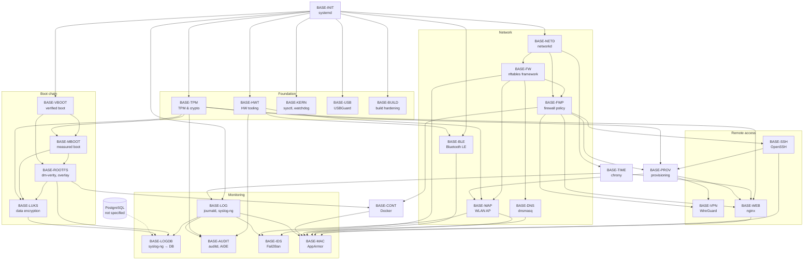

# Software Stack: Base System & Security

This folder specifies the base system layer of the Modberry image: init system, hardware interface tooling, TPM and cryptography, boot chain, network, remote access, container runtime, time, hardening and logging. Each file describes one module that can be implemented and verified on its own. The specification defines **what** the image must provide. It contains no implementation steps.

Device-specific values (UART paths, GPIO numbers, I2C addresses) are defined only in the [hardware specification](../../hardware/M40804W_MAX.md). The module files reference it.

> This folder replaces [`01_basic.md`](../01_basic.md). All modules of the basic stack are written; `01_basic.md` is no longer needed as reference and can be removed.

---

## 1. Conventions

- **Template:** every module file follows [`_TEMPLATE.md`](../_TEMPLATE.md).
- **Module ID:** `BASE-<MODULE>`, e.g. `BASE-TPM`.
- **Requirement ID:** `BASE-<MODULE>-<NN>`, e.g. `BASE-TPM-11`. From status `review` on, IDs are stable: they are never renumbered or reused. In status `draft`, IDs may still change.
- **Requirement levels:** `MUST` (part of the Definition of Done), `SHOULD` (implement unless a reason is documented), `MAY`.
- **Verification levels:** `build`, `manifest`, `rootfs` (no hardware needed), `device` (real hardware).
- **Traceability:** every row in *Configuration* and *Verification* names the requirement IDs it belongs to, so that tasks can be generated per requirement group (section `4.x`).
- **Spec status:** `planned` (file empty) → `draft` → `review` → `approved`. It describes the maturity of the specification, not its implementation. Only `approved` modules are handed over for implementation.
- **Implementation status:** is not kept in the specifications. It is kept per task in `agent/tasks/basic.json` (updated by the agents) and shown in the generated [`STATUS.md`](STATUS.md). Agents never edit the specifications.
- **Open points:** each open point ends as **Decided** (requirement updated) or **Deferred** (with reason). A deferred point that needs a measurement or test on the device becomes a verification task; a requirement affected by a deferred point is blocked until it is resolved.
- **Image composition:** the image contains only packages that a module lists under *Components*. Packages that no module lists are removed or added to a module.
- **OTA:** this layer contains no OTA-specific configuration. OTA machine configurations, OTA packages and OTA accounts are defined device-specifically in `meta-ota`. `meta-ota` extends this layer only through the extension points of the modules (e.g. `/etc/nftables.d/`, `/etc/dnsmasq.d/`, image bbappend) and must meet their requirements (e.g. `BASE-INIT-46`).

---

## 2. Module Overview

| Module ID | File | Purpose | Depends on | Risk | Spec status |
| :-- | :-- | :-- | :-- | :-- | :-- |
| `BASE-INIT` | [01_init.md](01_init.md) | systemd, image variants, accounts, service sandboxing | — | medium | `draft` |
| `BASE-HWT` | [02_hw-tooling.md](02_hw-tooling.md) | CAN/I2C/UART tools, fuser, udev rules, group `fieldbus` | INIT | low | `draft` |
| `BASE-TPM` | [03_tpm.md](03_tpm.md) | TPM driver, tpm2-tss, tpm2-tools, OpenSSL provider | INIT | medium | `draft` |
| `BASE-TIME` | [04_time.md](04_time.md) | chrony with NTS, RTC fallback, NTP server, UTC | INIT, NETD | low | `draft` |
| `BASE-LOG` | [05_logging.md](05_logging.md) | journald, syslog-ng (local) | INIT, TIME | low | `draft` |
| `BASE-LOGDB` | [06_log-database.md](06_log-database.md) | syslog-ng → PostgreSQL | LOG, ROOTFS, LUKS, *PostgreSQL* | low | `draft` |
| `BASE-PROV` | [07_provisioning.md](07_provisioning.md) | Factory provisioning, factory reset | INIT, TPM, FWP, SSH | high | `draft` |
| `BASE-CONT` | [08_container.md](08_container.md) | Docker without network exposure, userns, nftables integration | INIT, FW, FWP, ROOTFS, MAC | high | `draft` |
| `BASE-NETD` | [network/01_networkd.md](network/01_networkd.md) | systemd-networkd, segments, uplink fallback, resolved | INIT | medium | `draft` |
| `BASE-FW` | [network/02_firewall.md](network/02_firewall.md) | nftables framework: chains, policies, ban sets, logging | INIT, NETD | high | `draft` |
| `BASE-FWP` | [network/03_firewall-policy.md](network/03_firewall-policy.md) | Port/forward/output matrices, `service_nets`, NAT | FW, NETD, PROV | high | `draft` |
| `BASE-WAP` | [network/04_wlan-ap.md](network/04_wlan-ap.md) | hostapd: IoT WLAN (`bynacon-iot`), service AP in service mode, WPA3 | INIT, HWT, NETD, FW, PROV | medium | `draft` |
| `BASE-DNS` | [network/05_dhcp-dns.md](network/05_dhcp-dns.md) | dnsmasq for the IoT and service segments | INIT, NETD, FW | low | `draft` |
| `BASE-VPN` | [network/07_vpn.md](network/07_vpn.md) | WireGuard client to the Bynacon VPN server | INIT, NETD, FWP, PROV | high | `draft` |
| `BASE-SSH` | [network/08_ssh.md](network/08_ssh.md) | OpenSSH, key-only, Bynacon service key | INIT, FWP, PROV | high | `draft` |
| `BASE-WEB` | [network/09_web-proxy.md](network/09_web-proxy.md) | nginx TLS proxy, TPM key, Bynacon CA | INIT, FWP, TPM, TIME, PROV | medium | `draft` |
| `BASE-BLE` | [network/10_bluetooth.md](network/10_bluetooth.md) | BlueZ LE-only for sensors | INIT | medium | `draft` |
| `BASE-VBOOT` | [boot-chain/01_verified-boot.md](boot-chain/01_verified-boot.md) | U-Boot verified boot (signed FIT), anti-rollback | INIT | high | `draft` |
| `BASE-MBOOT` | [boot-chain/02_measured-boot.md](boot-chain/02_measured-boot.md) | TPM measured boot | TPM, VBOOT | high | `draft` |
| `BASE-ROOTFS` | [boot-chain/03_rootfs-integrity.md](boot-chain/03_rootfs-integrity.md) | dm-verity, read-only rootfs, overlay, partition layout | VBOOT, MBOOT | high | `draft` |
| `BASE-LUKS` | [boot-chain/04_data-encryption.md](boot-chain/04_data-encryption.md) | LUKS data partition, TPM-sealed key | TPM, MBOOT, ROOTFS | high | `draft` |
| `BASE-KERN` | [hardening/01_kernel.md](hardening/01_kernel.md) | sysctl hardening, watchdog, module signing | INIT | medium | `draft` |
| `BASE-MAC` | [hardening/02_mac.md](hardening/02_mac.md) | AppArmor profiles | INIT, all service modules | medium | `draft` |
| `BASE-AUDIT` | [hardening/03_audit-integrity.md](hardening/03_audit-integrity.md) | auditd, AIDE | INIT, HWT, TPM, LOG | low | `draft` |
| `BASE-IDS` | [hardening/04_intrusion.md](hardening/04_intrusion.md) | Fail2Ban (SSH, WLAN, port scans), hostapd event scripts | INIT, FW, WAP, LOG | medium | `draft` |
| `BASE-USB` | [hardening/05_usb.md](hardening/05_usb.md) | USBGuard, kernel default deny, host mode only | INIT | high | `draft` |
| `BASE-BUILD` | [hardening/06_build.md](hardening/06_build.md) | Compiler/kernel hardening, image content, CVE check, SBOM, pinned layers | INIT | medium | `draft` |

Risk `high` means that an error can make the device unbootable or lock out remote access. These modules need a human gate before they are deployed on hardware.

---

## 3. Dependency Graph

An arrow `A --> B` means: B depends on A, so A must be implemented first.

`BASE-MAC` comes last: AppArmor profiles can only be written once the services they confine exist.

---

## 4. Implementation Order

The order follows the dependency graph and the risk. Low-risk modules that can be verified without hardware (`manifest`, `rootfs`) come first. The boot chain comes last, because it changes the partition layout and can make the device unbootable.

| Phase | Modules | Goal | Gate |
| :-- | :-- | :-- | :-- |
| **0 – Cleanup** | — | Create the distro conf `conf/distro/modberry.conf`. Define the production and debug image variants. Remove legacy components that conflict with the specification: `dhcpcd`, `init-ifupdown`, `ifplugd`, `iptables`, `wpa-supplicant`, `systemd-timesyncd`, `hostapddeamon`, `dropbear`. Change the WLAN credentials and the AP passphrase that are in the Git history. Add the layers `meta-security` and `meta-webserver` to the build script and `LAYERDEPENDS`. Decide the LTS migration (`BASE-BUILD` open point 1). Build and verify the board device tree patch. | Image builds and boots, all devices of the hardware spec present |
| **1 – Foundation** | `BASE-INIT`, `BASE-BUILD`, `BASE-HWT`, `BASE-TPM` | systemd-only image, hardened build, bus access, working TPM | `systemctl --failed` empty, `/dev/tpmrm0` present, CVE report produced |
| **2 – Network** | `BASE-NETD`, `BASE-FW`, `BASE-FWP`, `BASE-DNS`, `BASE-WAP` | All interfaces via networkd, firewall with matrices | **Human gate:** firewall tested with console access |
| **3 – Services** | `BASE-TIME`, `BASE-LOG`, `BASE-SSH`, `BASE-VPN`, `BASE-WEB`, `BASE-PROV` | Correct time, local logging, secured remote access, factory provisioning | **Human gate:** service-key login and provisioning work before password login is disabled and the first production image is flashed |
| **4 – Hardening & interfaces** | `BASE-KERN`, `BASE-USB`, `BASE-IDS`, `BASE-BLE` | Kernel hardening, USB allow list, intrusion detection, BLE | **Human gate:** USB allow list tested with console access (`lan1` is a USB device) |
| **5 – Boot chain** | `BASE-VBOOT` → `BASE-MBOOT` → `BASE-ROOTFS` → `BASE-LUKS` | Chain of trust from bootloader to data partition | **Human gate** for each module; recovery procedure documented and tested |
| **6 – Platform & monitoring** | `BASE-CONT`, `BASE-LOGDB`, `BASE-AUDIT`, `BASE-MAC` | Container runtime on `/data`, logs in the database, audit, AppArmor | AppArmor first in complain mode, then enforce |

`BASE-LOG` is implemented in phase 3, because `BASE-IDS` (phase 4) reads the journal. `BASE-CONT` and `BASE-LOGDB` follow in phase 6, after the encrypted data partition exists.

---

## 5. Shared Resources

Each shared resource has exactly one owner module. Other modules use it and never redefine it.

| Resource | Owner | Used by |
| :-- | :-- | :-- |
| systemd, unit integration and sandboxing rules | `BASE-INIT` | all modules |
| Distro conf `modberry`, image variants, accounts | `BASE-INIT` | all modules |
| Interface names, address plan, `.network` / `.netdev` convention | `BASE-NETD` | `BASE-FW`, `BASE-FWP`, `BASE-WAP`, `BASE-DNS`, `BASE-TIME`, `BASE-VPN`, `THREAD-*` |
| `.network` / `.netdev` file of an interface | module that owns the interface: `BASE-NETD` (`lan0`, `lan1`, `br-iot`, `can0`), `BASE-WAP` (`wlan0_iot`, `wlan0_svc`), `BASE-VPN` (`wg0`) | — |
| nftables table `inet filter`, ban sets, `/etc/nftables.d/` | `BASE-FW` | `BASE-FWP`, `BASE-IDS`, `BASE-CONT`, `THREAD-NAT64`, `meta-ota` |
| Port, forward and output matrix, allow list `service_nets`, NAT table | `BASE-FWP` | all modules with network services, `BASE-WEB`, `BASE-IDS` |
| dnsmasq, `/etc/dnsmasq.d/` | `BASE-DNS` | `THREAD-NAT64` (DNS64), application layer |
| hostapd control interface, service AP | `BASE-WAP` | `BASE-IDS`, `BASE-FWP`, `BASE-WEB` |
| Service mode (user button, 30 min) | `BASE-HWT` | `BASE-WAP`, `BASE-BLE` |
| `/dev/tpmrm0`, TSS2, OpenSSL TPM provider | `BASE-TPM` | `BASE-MBOOT`, `BASE-ROOTFS`, `BASE-LUKS`, `BASE-WEB`, `BASE-PROV` |
| Persistent device names (serial, CAN), group `fieldbus` | `BASE-HWT` | `BASE-AUDIT`, `BASE-MAC`, application layer |
| System time, `time-sync.target` | `BASE-TIME` | `BASE-WEB`, `BASE-VPN`, `BASE-LOG` |
| Persistent data partition, persistent paths | `BASE-ROOTFS` / `BASE-LUKS` | `BASE-LOG`, `BASE-LOGDB`, `BASE-AUDIT`, `BASE-CONT`, application layer |
| Journal, syslog-ng source and `conf.d` | `BASE-LOG` | `BASE-LOGDB`, `BASE-IDS`, `BASE-AUDIT` |
| Provisioned per-device data `/data/provisioning/` | `BASE-PROV` | `BASE-WAP`, `BASE-BLE`, `BASE-FWP`, `BASE-SSH`, `BASE-VPN`, `BASE-WEB`, `BASE-TPM` |
| Bynacon service key | `BASE-SSH` | `BASE-PROV` |
| Container runtime | `BASE-CONT` | application layer |
| Build hardening, CVE report, SBOM | `BASE-BUILD` | release process, OTA layer |

---

## 6. Open Points Across Modules

| # | Question | Affects | Decision |
| :-- | :-- | :-- | :-- |
| 1 | PostgreSQL is used by `BASE-LOGDB` but not specified. Which module or stack owns it? | `BASE-LOGDB` | **Deferred:** application layer. |
| 2 | The layer has no distro configuration. Create `conf/distro/modberry.conf`? | `BASE-INIT`, all modules | **Decided:** distro conf in this layer (`BASE-INIT-02`). |
| 3 | `LAYERDEPENDS` of the layer. | all modules | **Decided:** `core raspberrypi openembedded-layer meta-python networking-layer webserver security tpm-layer virtualization-layer`; `README.md` lists the same layers. The build script must also add `meta-security` and `meta-webserver`. |
| 4 | Hardware spec: GPIO05 is the interrupt line of both the TPM and the DS2482S. | `BASE-TPM` | **Decided:** GPIO05 is the TPM interrupt; the DS2482S has no interrupt line (hardware spec updated). |
| 5 | U-Boot signing keys "stored in the TPM" (source spec). | `BASE-VBOOT` | **Decided:** private key on the build host, public key in U-Boot. |
| 6 | Production and debug image variants. | `BASE-INIT-40`, all modules | **Decided:** one image recipe, switch `MODBERRY_DEBUG = "1"` (`BASE-INIT-42` … `BASE-INIT-44`). |
| 7 | WLAN credentials and the AP passphrase are in the Git history. | `BASE-WAP` | **Interim done:** values moved to the non-versioned `secrets_kirkstone.conf`. **Decided:** factory provisioning (`BASE-PROV`). Open: change the old values. |
| 8 | Value of the placeholder `VPN_ENDPOINT` (port, VPN subnet). | `BASE-FWP`, `BASE-VPN` | **Deferred:** infrastructure information. |
| 9 | An LTE modem is allowed as USB device (`BASE-USB-05`). Uplink role, priority and firewall rules of an LTE uplink are not yet specified. | `BASE-NETD`, `BASE-FWP` | **Deferred:** specified when the modem model is chosen. |
| 10 | **Kirkstone is end of life since April 2026.** Migration to a supported LTS release affects every module (recipe versions, U-Boot, systemd, OpenSSL). | all modules | See `BASE-BUILD` open point 1. |
| 11 | USB service port and LAN9514 share the only USB controller of the CM4. | `BASE-USB` | **Decided:** no USB service port; local service access via the service AP (`BASE-WAP-40`); USB controller in host mode only (`BASE-USB-07`). |
