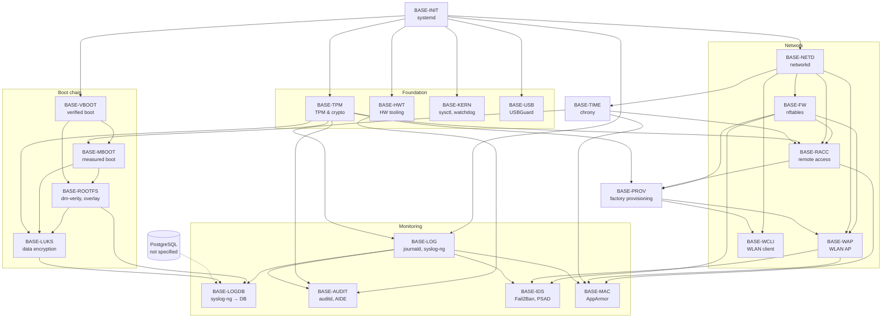

# Software Stack: Base System & Security

This folder specifies the base system layer of the Modberry image: init system, hardware interface tooling, TPM and cryptography, boot chain, network, time, hardening and logging. Each file describes one module that can be implemented and verified on its own. The specification defines **what** the image must provide. It contains no implementation steps.

Device-specific values (UART paths, GPIO numbers, I2C addresses) are defined only in the [hardware specification](../../hardware/M40804W_MAX.md). The module files reference it.

> This folder replaces [`01_basic.md`](../01_basic.md). All modules of the basic stack are written; `01_basic.md` is no longer needed as reference and can be removed.

---

## 1. Conventions

- **Template:** every module file follows [`_TEMPLATE.md`](../_TEMPLATE.md).
- **Module ID:** `BASE-<MODULE>`, e.g. `BASE-TPM`.
- **Requirement ID:** `BASE-<MODULE>-<NN>`, e.g. `BASE-TPM-11`. From status `review` on, IDs are stable: they are never renumbered or reused. In status `draft`, IDs may still change.
- **Requirement levels:** `MUST` (part of the Definition of Done), `SHOULD` (implement unless a reason is documented), `MAY`.
- **Verification levels:** `build`, `manifest`, `rootfs` (no hardware needed), `device` (real hardware).
- **Module status:** `planned` (file empty) → `draft` → `review` → `approved`. Only `approved` modules are handed over for implementation.
- **Open points:** each open point ends as **Decided** (requirement updated) or **Deferred** (with reason). A deferred point that needs a measurement or test on the device becomes a verification task; a requirement affected by a deferred point is blocked until it is resolved.
- **Image composition:** the image contains only packages that a module lists under *Components*. Packages that no module lists are removed or added to a module.
- **OTA:** this layer contains no OTA-specific configuration. OTA machine configurations, OTA packages and OTA accounts are defined device-specifically in `meta-ota`. `meta-ota` extends this layer only through the extension points of the modules (e.g. `/etc/nftables.d/`, `/etc/dnsmasq.d/`, image bbappend) and must meet their requirements (e.g. `BASE-INIT-46`).

---

## 2. Module Overview

| Module ID | File | Purpose | Depends on | Risk | Status |
| :-- | :-- | :-- | :-- | :-- | :-- |
| `BASE-INIT` | [01_init.md](01_init.md) | systemd as init system and service manager | — | medium | `draft` |
| `BASE-HWT` | [02_hw-tooling.md](02_hw-tooling.md) | CAN/I2C/UART tools, fuser, udev rules | INIT | low | `draft` |
| `BASE-TPM` | [03_tpm.md](03_tpm.md) | TPM driver, tpm2-tss, tpm2-tools, OpenSSL | INIT | medium | `draft` |
| `BASE-TIME` | [04_time.md](04_time.md) | chrony with NTS, RTC fallback, NTP server | INIT, NETD | low | `draft` |
| `BASE-LOG` | [05_logging.md](05_logging.md) | journald, syslog-ng (local) | INIT, TIME | low | `draft` |
| `BASE-LOGDB` | [06_log-database.md](06_log-database.md) | syslog-ng → PostgreSQL | LOG, ROOTFS, LUKS, *PostgreSQL* | low | `draft` |
| `BASE-PROV` | [07_provisioning.md](07_provisioning.md) | Factory provisioning of per-device data | INIT, TPM, FW, RACC | high | `draft` |
| `BASE-NETD` | [network/01_networkd.md](network/01_networkd.md) | systemd-networkd, segments (LAN0, IoT, guest), uplink fallback | INIT | medium | `draft` |
| `BASE-FW` | [network/02_firewall.md](network/02_firewall.md) | nftables base ruleset, port matrix, ban sets | INIT, NETD | high | `draft` |
| `BASE-WAP` | [network/03_wlan-ap.md](network/03_wlan-ap.md) | hostapd (IoT + guest WLAN), dnsmasq | INIT, NETD, FW | medium | `draft` |
| `BASE-WCLI` | [network/04_wlan-client.md](network/04_wlan-client.md) | iwd | INIT, NETD | low | `draft` |
| `BASE-RACC` | [network/05_remote-access.md](network/05_remote-access.md) | WireGuard client, OpenSSH, nginx | INIT, NETD, FW, TPM, TIME, PROV | high | `draft` |
| `BASE-VBOOT` | [boot-chain/01_verified-boot.md](boot-chain/01_verified-boot.md) | U-Boot verified boot (signed FIT) | INIT | high | `draft` |
| `BASE-MBOOT` | [boot-chain/02_measured-boot.md](boot-chain/02_measured-boot.md) | TPM measured boot | TPM, VBOOT | high | `draft` |
| `BASE-ROOTFS` | [boot-chain/03_rootfs-integrity.md](boot-chain/03_rootfs-integrity.md) | dm-verity, read-only rootfs, overlay, partition layout | VBOOT, MBOOT | high | `draft` |
| `BASE-LUKS` | [boot-chain/04_data-encryption.md](boot-chain/04_data-encryption.md) | LUKS data partition, TPM-sealed key | TPM, MBOOT, ROOTFS | high | `draft` |
| `BASE-KERN` | [hardening/01_kernel.md](hardening/01_kernel.md) | sysctl hardening, hardware watchdog | INIT | medium | `draft` |
| `BASE-MAC` | [hardening/02_mac.md](hardening/02_mac.md) | AppArmor profiles | INIT, all service modules | medium | `draft` |
| `BASE-AUDIT` | [hardening/03_audit-integrity.md](hardening/03_audit-integrity.md) | auditd, AIDE | INIT, HWT, TPM, LOG | low | `draft` |
| `BASE-IDS` | [hardening/04_intrusion.md](hardening/04_intrusion.md) | Fail2Ban, port scan detection, hostapd event scripts | INIT, FW, WAP, LOG | medium | `draft` |
| `BASE-USB` | [hardening/05_usb.md](hardening/05_usb.md) | USBGuard | INIT | high | `draft` |

Risk `high` means that an error can make the device unbootable or lock out remote access. These modules need a human gate before they are deployed on hardware.

---

## 3. Dependency Graph

An arrow `A --> B` means: B depends on A, so A must be implemented first.

`BASE-MAC` comes last: AppArmor profiles can only be written once the services they confine exist.

---

## 4. Implementation Order

The order follows the dependency graph and the risk. Low-risk modules that can be verified without hardware (`manifest`, `rootfs`) come first. The boot chain comes last, because it changes the partition layout and can make the device unbootable.

| Phase | Modules | Goal | Gate |
| :-- | :-- | :-- | :-- |
| **0 – Cleanup** | — | Create the distro conf `conf/distro/modberry.conf`. Define the production and debug image variants. Remove legacy components that conflict with the specification: `dhcpcd`, `init-ifupdown`, `ifplugd`, `iptables`, `wpa-supplicant`, `systemd-timesyncd`, `hostapddeamon`, `dropbear`. Change the WLAN credentials and the AP passphrase that are in the Git history (removed from the versioned files). Add missing layer dependencies (`meta-security`, `meta-networking`). Build and verify the board device tree patch (applied again since the override fix). | Image builds and boots, all devices of the hardware spec present |
| **1 – Foundation** | `BASE-INIT`, `BASE-HWT`, `BASE-TPM` | systemd-only image, bus access, working TPM | `systemctl --failed` empty, `/dev/tpmrm0` present |
| **2 – Network** | `BASE-NETD`, `BASE-FW`, `BASE-WCLI`, `BASE-WAP` | All interfaces via networkd, base firewall | **Human gate:** firewall tested with console access |
| **3 – Services** | `BASE-TIME`, `BASE-LOG`, `BASE-RACC`, `BASE-PROV` | Correct time, local logging, secured remote access, factory provisioning | **Human gate:** service-key login and provisioning work before password login is disabled and the first production image is flashed |
| **4 – Hardening** | `BASE-KERN`, `BASE-USB`, `BASE-IDS` | Kernel hardening, USB whitelist, intrusion detection | **Human gate:** USB allow list tested with console access (`lan1` is a USB device) |
| **5 – Boot chain** | `BASE-VBOOT` → `BASE-MBOOT` → `BASE-ROOTFS` → `BASE-LUKS` | Chain of trust from bootloader to data partition | **Human gate** for each module; recovery procedure documented and tested |
| **6 – Monitoring** | `BASE-LOGDB`, `BASE-AUDIT`, `BASE-MAC` | Logs in the database, audit, AppArmor | AppArmor first in complain mode, then enforce |

`BASE-LOG` is implemented in phase 3, because `BASE-IDS` (phase 4) reads the journal. `BASE-LOGDB` follows in phase 6, after the encrypted data partition and PostgreSQL exist.

---

## 5. Shared Resources

Each shared resource has exactly one owner module. Other modules use it and never redefine it.

| Resource | Owner | Used by |
| :-- | :-- | :-- |
| systemd, unit integration rules | `BASE-INIT` | all modules |
| Interface names, address plan, `.network` / `.netdev` convention | `BASE-NETD` | `BASE-FW`, `BASE-WAP`, `BASE-TIME`, `BASE-RACC`, `THREAD-*` |
| `.network` / `.netdev` file of an interface | module that owns the interface: `BASE-NETD` (`lan0`, `lan1`, `br-iot`, `wlan0_sta`, `can0`), `BASE-WAP` (`wlan0_iot`, `wlan0_guest`), `BASE-RACC` (`wg0`) | — |
| Port, forward and output matrix, allow list `service_nets` | `BASE-FW` | all modules with network services, commissioning |
| nftables table `inet filter`, ban sets, `/etc/nftables.d/` | `BASE-FW` | `BASE-IDS` (ban sets), `BASE-TIME`, `BASE-RACC`, `THREAD-NAT64` |
| dnsmasq, `/etc/dnsmasq.d/` | `BASE-WAP` | `THREAD-NAT64` (DNS64) |
| hostapd control interface | `BASE-WAP` | `BASE-IDS` |
| `/dev/tpmrm0`, TSS2, OpenSSL TPM provider | `BASE-TPM` | `BASE-MBOOT`, `BASE-ROOTFS`, `BASE-LUKS`, `BASE-RACC` |
| Persistent device names (serial, CAN) | `BASE-HWT` | `BASE-AUDIT`, `BASE-MAC`, application layer |
| System time, `time-sync.target` | `BASE-TIME` | `BASE-RACC`, `BASE-LOG` |
| Persistent data partition, persistence of `/var/log` | `BASE-ROOTFS` / `BASE-LUKS` | `BASE-LOG`, `BASE-LOGDB`, `BASE-AUDIT`, application layer |
| Journal, syslog-ng source and `conf.d` | `BASE-LOG` | `BASE-LOGDB`, `BASE-IDS`, `BASE-AUDIT` |
| Distro conf `modberry`, image variants, accounts | `BASE-INIT` | all modules |
| Provisioned per-device data `/data/provisioning/` | `BASE-PROV` | `BASE-WAP`, `BASE-WCLI`, `BASE-FW`, `BASE-RACC`, `BASE-TPM` |
| Bynacon service key | `BASE-RACC` | `BASE-PROV` |

---

## 6. Open Points Across Modules

| # | Question | Affects | Decision |
| :-- | :-- | :-- | :-- |
| 1 | PostgreSQL is used by `BASE-LOGDB` but not specified. Which module or stack owns it? | `BASE-LOGDB` | **Deferred:** application layer. |
| 2 | The layer has no distro configuration. Distro settings (`INIT_MANAGER`, `DISTRO_FEATURES`) currently come from `local.conf`. Create `conf/distro/modberry.conf`? | `BASE-INIT`, all modules | **Decided:** distro conf in this layer (`BASE-INIT-02`). |
| 3 | `README.md` of the layer lists only `poky`, `meta-raspberrypi`, `meta-openembedded`, `meta-security`, `meta-virtualization`. `layer.conf` declares only `core` in `LAYERDEPENDS`. Add the required layers there? | all modules | **Decided:** `LAYERDEPENDS` = `core raspberrypi openembedded-layer meta-python networking-layer webserver security tpm-layer`; `README.md` lists the same layers. The build script must also add `meta-security` and `meta-webserver`. |
| 4 | Hardware spec: GPIO05 is the interrupt line of both the TPM and the DS2482S. Marked as open in the hardware spec; to be verified against the schematic. | `BASE-TPM` | **Deferred:** needs the schematic → verification task. |
| 5 | The source spec states that U-Boot signing keys are stored in the TPM. With U-Boot verified boot, the private key stays on the build host and the public key is embedded in U-Boot. Clarify in `BASE-VBOOT`. | `BASE-VBOOT` | **Decided:** private key on the build host, public key in U-Boot (`BASE-VBOOT`, section 8). |
| 6 | How are the production and debug image variants defined (two image recipes or an `IMAGE_FEATURES` switch)? `debug-tweaks` is enabled today for every build. | `BASE-INIT-40`, all modules | **Decided:** one image recipe, switch `MODBERRY_DEBUG = "1"` (`BASE-INIT-42` … `BASE-INIT-44`). |
| 7 | WLAN credentials and the AP passphrase are in the Git history (`hostapd.conf`, `scripts/Yocto/local_kirkstone.conf`). They must be changed on all devices, and a per-device provisioning is needed (`BASE-WAP-14`, `BASE-WCLI-20`). | `BASE-WAP`, `BASE-WCLI` | **Interim done:** values moved to the non-versioned `scripts/Yocto/secrets_kirkstone.conf`. **Decided:** factory provisioning (`BASE-PROV`). Open: change the old values. |
| 8 | Value of the placeholder `VPN_ENDPOINT` (port, VPN subnet). | `BASE-FW`, `BASE-RACC` | **Deferred:** infrastructure information. |
| 9 | An LTE modem is allowed as USB device (`BASE-USB-05`). Uplink role, priority and firewall rules of an LTE uplink are not yet specified. | `BASE-NETD`, `BASE-FW` | **Deferred:** specified when the modem model is chosen. |
