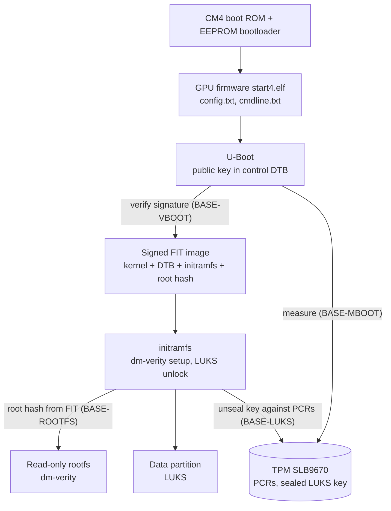

# Boot Chain: Overview

This folder specifies the chain of trust of the Modberry from the bootloader to the encrypted data partition. The four modules depend on each other and are implemented in this order:

| Order | Module | File | Protects |
| :-- | :-- | :-- | :-- |
| 1 | `BASE-VBOOT` | [01_verified-boot.md](01_verified-boot.md) | Kernel, device tree and initramfs are signed and verified by U-Boot |
| 2 | `BASE-MBOOT` | [02_measured-boot.md](02_measured-boot.md) | Every boot stage is measured into TPM PCRs |
| 3 | `BASE-ROOTFS` | [03_rootfs-integrity.md](03_rootfs-integrity.md) | Read-only root filesystem verified block by block (dm-verity), writable overlay, partition layout |
| 4 | `BASE-LUKS` | [04_data-encryption.md](04_data-encryption.md) | Data partition encrypted; key released by the TPM only for the expected boot state |

---

## 1. Boot Sequence

---

## 2. Partition Layout (basic image)

| # | Partition | Filesystem | Mounted at | Content | Owner |
| :-- | :-- | :-- | :-- | :-- | :-- |
| 1 | boot | vfat | `/boot` (read-only) | GPU firmware, `config.txt`, U-Boot, signed FIT image | `BASE-VBOOT` |
| 2 | rootfs | ext4 + dm-verity hash tree | `/` (read-only) | root filesystem | `BASE-ROOTFS` |
| 3 | data | LUKS2 → ext4 | `/data` | persistent device data | `BASE-ROOTFS`, `BASE-LUKS` |

The OTA layer may change this layout (e.g. A/B root partitions). It must meet the requirements of the four modules. This is coordinated when `meta-ota` is worked on.

---

## 3. Root of Trust

The CM4 boot ROM and the GPU firmware do not verify U-Boot by default. Without the Raspberry Pi secure boot (signed `boot.img`, customer key in the OTP of the CM4), an attacker with physical access can replace U-Boot or `config.txt` on the boot partition. The chain of this folder then still detects the change through measured boot: the TPM does not release the LUKS key, and remote attestation shows a different PCR state. Raspberry Pi secure boot closes this gap, but programming the OTP is irreversible (see `BASE-VBOOT` open point 1).

---

## 4. Rules for All Boot Chain Modules

- **Human gate:** every change of the boot chain is tested on a lab device with console access and a documented recovery procedure (reflash via `rpiboot`) before it is used on any other device.
- Private signing keys never enter the device or the repository. They are kept on the build host or in an HSM.
- A failed verification stops the boot. There is no fallback to an unverified boot path in the production image.
- The debug image (`MODBERRY_DEBUG = "1"`) may relax verification for development, but is marked as debug image (`BASE-INIT-44`).
